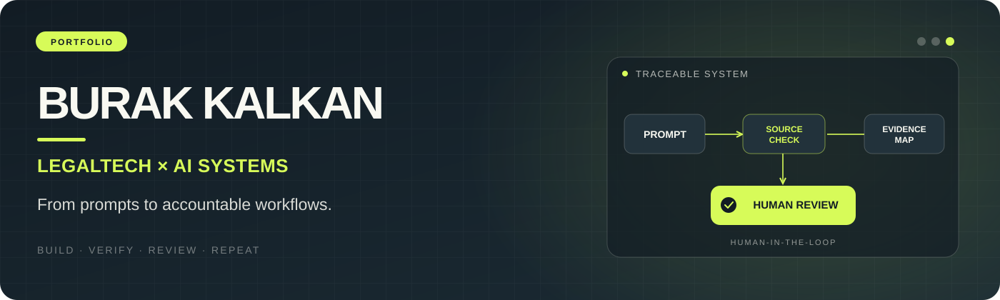

 

**Paralegal · LegalTech Specialist · AI Workflow Designer**

*Turning legal AI prompts into traceable, reusable, human-supervised workflows.*

[LinkedIn](https://www.linkedin.com/in/burakkalkann/) · [Instagram](https://www.instagram.com/burakk_kkalkan/) · [Open-source project](https://github.com/burakkalkan-lab/turkish-legal-artifacts)

---

### About

I'm **Burak Kalkan**, working at the intersection of **law, applied AI, and workflow engineering**. My focus is not just getting an answer from a model, but designing the steps around it: scope, source checks, structured evidence, clear limitations, and **human approval**.

I also mentor in **KamuKOD Workshop 290 — Hukuki Prompt Tasarımı ve Legal Engineer’a Giriş**, where I explore the move from individual prompts to repeatable workflows and responsible automation.

> **My approach:** Prompt → Workflow → Automation → Human Review.

### Selected work

<table>
  <tr>
    <th align="left">Project</th>
    <th align="left">Focus</th>
    <th align="left">Status</th>
  </tr>
  <tr>
    <td><a href="https://github.com/burakkalkan-lab/turkish-legal-artifacts"><b>Turkish Legal Artifacts</b></a></td>
    <td>Reusable Turkish-law AI skills and source/claim verification workflows; includes <b>Cite Check TR</b>.</td>
    <td>Public · Experimental</td>
  </tr>
  <tr>
    <td><b>LegalMask AI</b></td>
    <td>Local-first document masking and anonymization workflows.</td>
    <td>Independent work</td>
  </tr>
  <tr>
    <td><b>IUSTILEX Platform</b></td>
    <td>LegalTech workflows with local processing and data-protection considerations.</td>
    <td>Independent work</td>
  </tr>
  <tr>
    <td><b>Legal AI research workflows</b></td>
    <td>RAG, structured legal research, evidence mapping, and approval checkpoints.</td>
    <td>Research &amp; prototyping</td>
  </tr>
</table>

**A note on verification:** Turkish Legal Artifacts is an experimental toolkit, not an autonomous legal authority. A retrieved source and its support for a particular claim must be checked separately. Professional legal review remains essential.

### Areas I work on

| Legal AI | Systems & workflows | Responsible implementation |
| --- | --- | --- |
| Legal research · Citation checks · Evidence mapping | Prompt design · Agent skills · RAG · n8n concepts | Human-in-the-loop · Data minimization · KVKK awareness |

### What guides my work

- **Source-first reasoning:** distinguish an existing source from a source that actually supports a claim.
- **Platform independence:** aim for reusable workflows across Claude/Claude Code, OpenAI Codex, and prompt-capable environments.
- **Human accountability:** legal conclusions and externally shared outputs need appropriate human review.
- **Privacy-conscious design:** minimize unnecessary data exposure and prefer local processing when suitable.
- **Open learning:** turn real mistakes and repeatable methods into materials others can inspect and improve.

### Education & community

**Mentor — KamuKOD Workshop 290**  
*Hukuki Prompt Tasarımı ve Legal Engineer’a Giriş*  
Practical sessions on structured prompting, prompt libraries, workflows, automation thinking, and human approval.

### Connect

If you're exploring **LegalTech**, responsible AI adoption, practical workflow design, or open-source legal tooling, I'd be happy to connect on [LinkedIn](https://www.linkedin.com/in/burakkalkann/).

<b>Türkçe kısa tanıtım</b>

Hukuk, yapay zekâ ve süreç tasarımının kesişiminde çalışmalar yürütüyorum. Odağım yalnızca iyi prompt yazmak değil; kaynakları kontrol edilebilir, çıktıları izlenebilir ve insan onayını içeren iş akışları geliştirmek.

**Çalışma alanlarım:** Hukuki prompt mühendisliği, Legal Engineering, Türk hukuku için tekrar kullanılabilir AI becerileri, belge maskeleme, RAG, otomasyon ve AI yönetişimi.

**Açık kaynak:** [Turkish Legal Artifacts](https://github.com/burakkalkan-lab/turkish-legal-artifacts) — deneysel hukukî atıf inceleme becerileri ve yardımcı araçlar. Nihai hukukî değerlendirme uzman denetimi gerektirir.

**Eğitim:** KamuKOD Atölye 290'da mentörlük yapıyorum.

---

Built around clarity, evidence, and human oversight.

